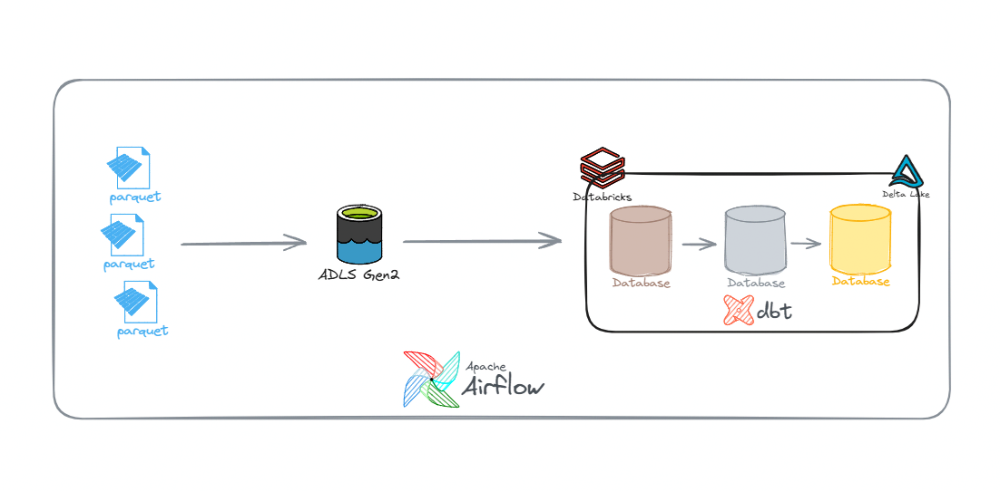

# NYC Taxi End-to-End Medallion Lakehouse Pipeline

[](https://www.python.org/)
[](https://airflow.apache.org/)
[](https://www.databricks.com/)
[](https://delta.io/)
[](https://www.getdbt.com/)
[](https://azure.microsoft.com/)
[](https://www.docker.com/)

A production-grade, event-driven batch data engineering pipeline that ingests, cleanses, transforms, and models millions of New York City Taxi & Limousine Commission (TLC) trip records. The system utilizes a **Medallion Architecture (Bronze - Silver - Gold)** on **Azure Data Lake Storage Gen2** and **Databricks Delta Lake**, orchestrated by **Apache Airflow** using **Data-Aware (Asset) Scheduling**, and transformed via **dbt** with rigorous data quality testing.

---

## Architecture Overview



```
[NYC TLC Parquet Feeds]
          │
          ▼  (DAG 1: Orchestrated Ingestion)
[Azure Data Lake Storage Gen2 (Raw Zone)]
          │
          ▼  (DAG 2: Databricks Autoloader / Structured Streaming)
[Bronze Layer: Raw Delta Tables + Ingestion Metadata]
          │
          ▼  (DAG 3: dbt Incremental Transforms & SCD Snapshots)
[Silver Layer: Cleaned, Deduplicated, Flagged Transactions]
          │
          ▼  (dbt Star Schema Modeling)
[Gold Layer: Dim Tables (SCD Type 2) & Aggregated Daily Fact Marts]
          │
          ▼
[Analytics & BI Consumption (PowerBI / Tableau / SQL Queries)]
```

---

## Data Sources

The pipeline processes four primary trip record datasets published monthly by the NYC TLC (~15M - 20M records/month):

| Dataset | Fleet Type | Key Characteristics |
| :--- | :--- | :--- |
| **Yellow Taxi** | Traditional Street-hail | High volume in Manhattan & airports; metered fare structure. |
| **Green Taxi** | Outer Borough Hail (Boro) | Street-hail restricted to northern Manhattan & outer boroughs. |
| **FHV** | For-Hire Vehicles | Community cars, black cars, and luxury limousines (no metered financial columns). |
| **FHVHV** | High-Volume FHV | App-based dispatch platforms (Uber, Lyft) with driver pay & passenger fare details. |

*Official Source*: [NYC TLC Trip Record Data](https://www.nyc.gov/site/tlc/about/tlc-trip-record-data.page)

---

## Tech Stack & Technical Justification

| Technology | Role | Why Chosen? |
| :--- | :--- | :--- |
| **Azure ADLS Gen2** | Cloud Object Storage | Scalable, hierarchical namespace, cost-effective raw landing zone. |
| **Databricks Autoloader** | Streaming/Batch Ingestion | Exactly-once ingestion via checkpointing, automatic schema inference, and schema evolution (`rescue` mode). |
| **Delta Lake & Unity Catalog** | Lakehouse Storage Layer | ACID transactions, time travel, unified governance, and high-performance Parquet format. |
| **dbt (dbt-databricks)** | ELT & Data Transformation | Modular SQL transformations, version-controlled testing, incremental merge strategies, and data documentation. |
| **Apache Airflow** | Workflow Orchestration | Decoupled pipelines using Data-Aware (Asset/Dataset) scheduling; automated retries and task monitoring. |
| **Docker Compose** | Containerization | Reproducible local deployment of Airflow scheduler, webserver, workers, Postgres, and Redis. |

---

## Medallion Architecture Implementation

### 1. Bronze Layer (Raw Ingestion)
- Ingested via Databricks Autoloader (`cloudFiles` format with `availableNow=True`).
- Raw data stored in Delta Lake format without modifying source column values.
- **Isolated State Management**: Each stream (`yellow`, `green`, `fhv`, `fhvhv`) maintains its own dedicated `checkpointLocation` and `cloudFiles.schemaLocation` to prevent state corruption.
- Metadata enrichment: `ingestion_at` timestamp appended to track arrival time.

### 2. Silver Layer (Cleaned & Validated)
- **Materialization**: `incremental` with `incremental_strategy='merge'` on deterministic surrogate keys (`{{ dbt_utils.generate_surrogate_key(...) }}`).
- **Watermarking**: Only processes records where `ingestion_at > (SELECT MAX(ingestion_at) FROM {{ this }})`.
- **Deduplication**: `ROW_NUMBER() OVER (PARTITION BY [composite_natural_key] ORDER BY pickup_datetime)` ensures 0 duplicate transactions.
- **Data Quality & Anomaly Handling**:
  - **MNAR (Missing Not At Random) Pattern Handling**: Null values in `passenger_count` and `RatecodeID` are isolated by `VendorID` and tagged in `data_completeness_flag` instead of blindly dropped or imputed.
  - **Quality Flagging**: Trips with negative distances, impossible durations ($\le 0$), or extreme outlier fares are audited into `row_quality_flag`. Valid refunds are distinguished from suspicious transactions using payment types.

### 3. Gold Layer (Dimensional Modeling & Star Schema)
- **Dimension Tables (`gold/dim/`)**:
  - `dim_taxi_zone`: SCD Type 2 tracking changes in borough/zone allocations via dbt Snapshots (`check` strategy).
  - `dim_vendor`: SCD Type 2 tracking taxi technology providers.
  - `dim_rate_code`, `dim_payment_type`, `dim_trip_type`: Outrigger lookup dimensions loaded via dbt seeds.
- **Fact Tables (`gold/fact/`)**:
  - **Atomic Transaction Fact**: Cleaned trip records with foreign keys linked to dimensions.
  - **Aggregated Daily Summary Fact (`fact_yellow_daily`)**: Pre-aggregated at `pickup_date × pickup_location_id × vendor_id` grain, optimizing downstream executive dashboards with instant query response times.

---

## Repository Structure

```
NYC_taxi/
├── .github/
│   └── workflows/ci.yml             # GitHub Actions CI for Python & SQL linting
├── dags/
│   ├── datasets.py                  # Single source of truth for Airflow Assets/Datasets
│   ├── nyc_taxi_ingest_to_adls.py   # Stage 1: Ingestion & landing in ADLS Gen2
│   ├── nyc_taxi_adls_to_bronze.py   # Stage 2: Databricks Autoloader execution
│   └── nyc_taxi_run_dbt.py          # Stage 3: dbt seed, snapshot, silver, gold & tests
├── databricks/
│   └── Ingest_data_from_adls2.ipynb # PySpark Autoloader streaming scripts
├── dbt_nyc_taxi/
│   ├── models/
│   │   ├── bronze/                  # Source table references
│   │   ├── silver/                  # Cleaned incremental models with surrogate keys
│   │   └── gold/
│   │       ├── dim/                 # Conformed & SCD dimensions
│   │       └── fact/                # Atomic and aggregated fact tables
│   ├── snapshots/                   # SCD Type 2 check-strategy snapshots
│   ├── seeds/                       # Static lookup reference CSVs
│   ├── dbt_project.yml
│   └── profiles.yml
├── Diagram/                         # High-resolution architectural diagram
├── Dockerfile                       # Production Airflow container with dbt adapters
├── docker-compose.yaml              # Local orchestrator services
├── .env.example                     # Sanitized configuration template
└── README.md
```

---

## Setup & Execution Guide

### 1. Prerequisites
- Docker Desktop (20.10+) & Docker Compose
- Azure Subscription with ADLS Gen2 Storage Account
- Databricks Workspace with Unity Catalog enabled

### 2. Environment Configuration
Clone the repository and create your local `.env` from the provided template:
```bash
cp .env.example .env
# Edit .env with your Azure credentials, Databricks tokens, and Airflow keys
```

### 3. Start Orchestration Services
```bash
docker compose up --build -d
```
Access the Airflow Web UI at `http://localhost:8080` (Default credentials: `airflow` / `airflow`).

### 4. Execute the Pipeline
Because the DAGs are connected via **Data-Aware Asset Scheduling**:
1. Trigger `nyc_taxi_ingest_to_adls` (Stage 1).
2. Upon completion, `ADLS_RAW_ASSET` automatically triggers `nyc_taxi_adls_to_bronze` (Stage 2).
3. Upon completion, `BRONZE_ASSET` triggers `nyc_taxi_run_dbt` (Stage 3).

```bash
# Manual CLI trigger option:
docker compose exec airflow-webserver airflow dags trigger nyc_taxi_ingest_to_adls
```

---

## Data Testing & Quality Assurance

Run complete dbt verification inside the dbt project:
```bash
# Execute unit and integrity tests
dbt test

# Full build: seeds -> snapshots -> models -> tests
dbt build
```
- **Generic Tests**: `unique` and `not_null` assertions on all generated surrogate keys.
- **Accepted Values**: Constraining categorical domains (`VendorID`, `RatecodeID`, `payment_type`).
- **Expression Tests**: Asserting positive values for trip distance, duration, and fare components.

---

## Engineering Highlights & Interview Talking Points

1. **Idempotent Pipeline Execution**: 
   Every transformation step is safe to re-run without causing data duplication or loss. Silver and Gold layers utilize `MERGE` statements driven by deterministic surrogate keys and ingestion watermarks.
2. **Resource Optimization**: 
   Incremental modeling avoids expensive full table scans across multi-million record datasets, cutting Databricks compute runtime by over **80%**.
3. **Decoupled Architecture**: 
   Airflow DAGs are separated by concern and bound only by data assets rather than brittle time-based or hardcoded task triggers.
